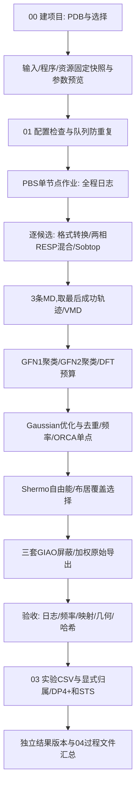

> 本页保留默认NMR基础说明。V2.1模块选择见 [QUICKSTART_V2.md](QUICKSTART_V2.md)，V1.2整合后的多样品归属、检查及批次收集见 [MULTISAMPLE.md](MULTISAMPLE.md)。02已使用实时阶段回执，03支持 --check-only；旧上下样品字段只作兼容。

# 自动化运行过程

本说明描述实际调用和故障边界，不把“自动化”理解为无需审核化学结构。科学参数表和方程见THEORY，文件准备见USER_GUIDE。

## 项目创建

00调用project_console.prepare：检查路径不能在程序目录内、目标不能已存在、输入齐全、所选方案有效、外部资源完整；init_project复制输入建立初始job。随后复制workflow快照、安装本地合法资源和工作簿、生成cluster_runtime.sh、写project.ini/计算方案/预览/四个入口，并保存程序版本SHA256.json。此时没有执行量化或qsub。

新增模板版本不会追溯覆盖旧项目。cluster.json被复制进项目快照用于固定环境；它不进入公共发布包。不要公开上传带本地路径/资源/研究输入的整个生产项目。

## 提交与运行环境

01先sync project.ini，校验字段、数值、方法与已有计算identity。仅后处理实验字段可以在已有计算后修改；科学条件变化会停止。queue_guard查询当前用户队列及提交记录中的作业，活动状态或查询异常时拒绝重复提交。

submit.sh加载本项目cluster_runtime.sh，检查软件/输入/资源，从集中配置生成qsub队列、核数、时间参数，将绝对JOB_CONFIG传给PBS。提交记录保留作业号和配置哈希。当前固定程序路径按项目创建时生成，不能运行中改名或搬动项目。

PBS脚本将工作流输出合并tee到运行日志/run_时间_作业.log；Gaussian（含RESP）和ORCA详细输出定向到各自独立日志，总日志只保留它们的起止/路径/返回值。MD、聚类及其他工具仍保留原有运行输出；加载module/路径/Gaussian环境，获得配置核数，使用flock锁定job.json，并执行nmrflow check/run。运行时验证PBS_NODEFILE单节点和CPU槽位、内存余量。输出目录另有Python文件锁，避免不同入口同时写同批结果。

退出时保留原返回码并整理过程文件；Gaussian/ORCA等各阶段还有自己的日志。搜索、聚类和工具stdout流入总日志；Gaussian/ORCA正文只写独立日志，事件索引记录开始、结束与返回码。断线不等于作业结束，先查调度器和文件状态。

## 每个候选内部

PDB候选依次采样；直接XYZ集合输入只适合高级用户，需Hartree能量注释/一致原子顺序，绕过PDB采样。GFN2后按能量预算选择并赋稳定构象ID，后续不按文件glob顺序配对能量/几何。

Gaussian优化有opt1、opt2、opt3固定模板回退，失败原始文件保留。DFT聚类输出映射回原父构象ID，重复构象记录排除原因。频率不合格记录为rejected_frequency，不冒充正常最低点。其他未解释软件/解析错误停止，不能任意忽略。

ORCA单点与Shermo按ID对接，构象manifest保存频率、电子能、Gibbs、原权重、入选NMR权重、覆盖和排除项。入选构象依次完成三分支NMR。所有候选成功后导出加权屏蔽；未提供完整实验归属时，raw_exports_complete_assignment_required是“原始数据已导出，等待归属”，不是计算失败。

## 状态、回执和续跑

|记录|作用|
|---|---|
|state.json|候选状态和输入/配置身份|
|sampling/receipt.json|采样输入与最终集合哈希|
|各量化阶段receipt.json|输入/输出哈希、验收状态|
|conformers.json|构象ID、文件路径、能量、权重、排除与NMR选择|
|程序版本SHA256.json|项目创建时程序与资源清单，供复核比对；阶段回执另核对实际输入输出|
|提交记录.json / workflow/submissions.tsv|提交历史，不据终端截图猜作业号|

完整且哈希一致阶段可以复用，改动既有输入/输出会被拒绝。不完整采样目前明确拒绝自动原地续接；需要保留原因并新项目重做。自动回退只包含已有固定优化模板/成功MD轨迹选择，不会擅改泛函、溶剂或分类。

## 后处理与可读视图

02只刷新状态、索引和摘要，不提交。新项目的output固定为项目内过程文件，Gaussian/ORCA从一开始就在那里写实际文件。04额外提取正常终止日志的构型、更新权重与结果汇总，不创建过程文件链接。旧项目继续兼容旧视图规则，不能在运行中迁移。

03扫描全部正式experiment_*.csv及兼容的单表配置，按显式归属逐样品比较，保存独立输入和结果版本。失败保留日志及已完成结果；比较读取现有量化输出。

人工最终负责结构、实验归属、采样稳定性、频率和参数适用性验收。软件状态complete只表示程序规定阶段完成。
