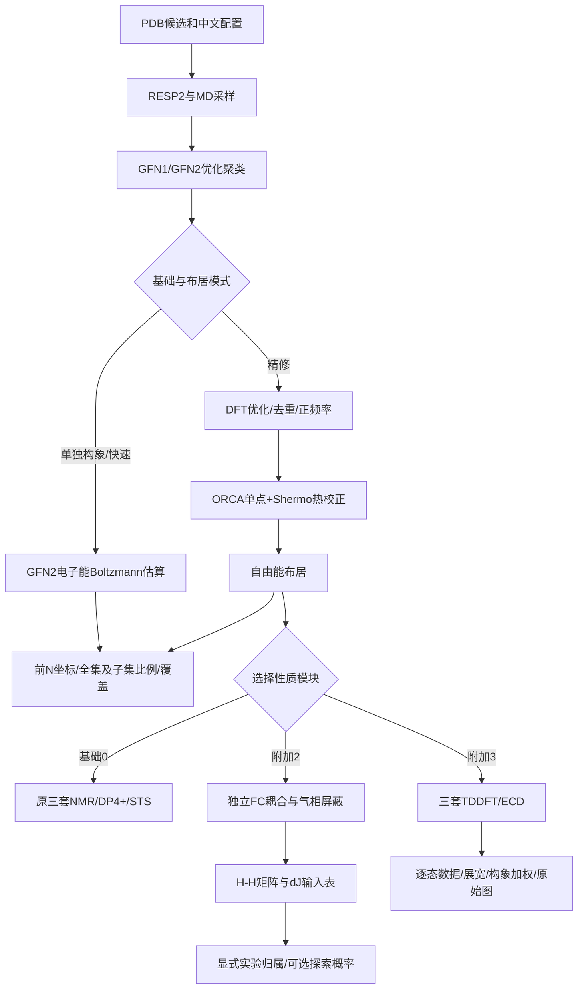

# V2 原理、运行顺序与脚本接口

## 共享计算与分支

共享的是优化后的同一批构象和已审核布居；NMR、J和ECD分别有自己的计算输入、阶段目录、receipt和导出目录。不同候选之间不做构象混合。

## 布居与截取

快速档使用`p_i ∝ exp[-(E_i-E_min)/(RT)]`，E为GFN2电子能；精修档把E换成G，G来自ORCA能量加Shermo热校正。按布居选择性质计算集合，累加达到配置的覆盖阈值后，对这部分重新归一化用于谱学加权。导出前N坐标是另一个独立筛选操作，始终保留全集比例和子集覆盖。

采样、DFT预算、频率剔除、聚类阈值与低频熵模型都会改变布居。沿用的Sobtop缺项/替代参数警告仍需逐项目审核；程序正常结束不能证明采样充分或力场参数准确。

## J计算与概率

FC贡献以Hz解析，保留带符号矩阵，禁止误读约化K或total J。完整三角矩阵须覆盖所有原子对，随后提取H–H。每个构象按相同ID连接权重；等价氢先按显式原子组平均，再选择保留符号或比较绝对值。

dJ使用独立气相B3LYP/6-31G(d,p)屏蔽回归得到缩放位移；J用作者统计表固定斜率/截距缩放，再用Student-t尾概率构建似然，在对数空间组合并在候选间归一化。原文统计与本版几何/布居条件不一致，所以默认输出表，概率须显式启用探索模式；没有实验J时不能得到实际dJ结论。

工作簿是计算结果快照，直接修改其中数字不会自动更新概率；应修改CSV再运行03。需要作者Excel的交互公式时，将导出的Type/Exp/候选数据粘贴到作者原表，并保留本项目元数据和差异说明。

## ECD转换与混合

解析每个TDDFT态的激发能、波长、振子强度及两种规范的旋光强度。每个构象先按选定规范和FWHM展宽，再以完整精度的布居加权；不同构象第n态不一定具有相同物理性质，因此不按态序号直接平均能量。

原始曲线使用Δε物理单位。可选能量缩放或波长平移只生成另一个显示版本，不删除原始跃迁或原始曲线。实验原文件、哈希及完整点列保留；不自动裁剪、平滑、补写基线、反号或寻找最佳平移。归一化图明确使用任意单位。

## 新增/修改脚本

| 文件 | 职责 | 需要用户手改吗 |
|---|---|---|
| module_options.py | 模块默认值、组合校验、中文INI与ECD输入参数 | 日常不改，用project.ini |
| conformer_exports.py | E/G权重、前N坐标、覆盖及比例 | 不改 |
| coupling.py | FC矩阵、等价组、3键核验、dJ表与探索概率 | 不改；统计参数改动需独立校准与版本化 |
| ecd.py | TD态解析、展宽、构象平均、CSV和图 | 不改，用模块后处理配置 |
| nmrflow.py | 共用计算，按模块条件调用J/ECD或跳过NMR | 不改 |
| project_console.py | 建项选项、配置同步、预览、原4入口 | 不改 |
| project_views.py | 中间文件、日志和模块结果集中查看 | 不改 |
| resources/08_coupling_*.gjf | J/屏蔽的独立科学输入 | 换理论等级须另建方案、核对校准后新建项目 |
| resources/07_tem0*_ecd.gjf | 原三套ECD模板 | 保留旧标准；溶剂/态数在INI设置 |

## 断点、证据与失败处理

每阶段签名绑定实际渲染输入和输出SHA256。J/ECD导出再次检查输入、输出、stage、几何及构象权重；输入改变或未结束日志不能静默续算。所有候选complete后才进行实验后处理。部分失败保存完整输出及未发布暂存目录，不覆盖既有正式导出。

同一输出目录的运行与后处理都先原子创建.workflow.guard，写入主机、PID、PBS作业号、时间和唯一持有者标识，然后申请内核文件锁。所有V2调用者都遵守相同目录互斥，避免登录节点和计算节点使用不同保护方式。ENOLCK/ENOSYS/EOPNOTSUPP只允许在仍持有目录互斥时继续；真正的锁竞争和其他I/O错误会停止。正常退出只释放属于自己的guard；崩溃遗留的guard不自动抢占。恢复前必须同时确认相关队列作业与后处理进程已停止，并保留owner记录。

模块输出先在独立暂存目录完成，再整体发布；旧版本移至previous目录。04把上一份集中模块视图移至历史快照，再复制当前结果，避免减少top_n后仍把旧XYZ误当本次导出。

验证分为数值/解析测试、默认NMR回归、ShellCheck、真实计算节点小分子调用。小分子验证只证明接口和输出链路可运行，不证明特定体系采样或dJ/ECD指认的科学准确率。四个用户结构的正式V1复算与V2开发分别保留身份和记录。

## V2.1入口复核补充

01先持有提交互斥、检查调度器，再同步INI并提交；除正式提交记录外，也检查SUBMISSION和workflow/submissions.tsv，避免qsub成功后上层记录失败导致重提。正式03也先核实队列。--check-only使用只读同步，不改job.json或预览，仍保存独立数据审核记录；尚未同步的科学条件改动会停止检查。

状态收集对暂不可读JSON保留提示；查看进度仍以阶段回执与真实队列共同判断。建项复制不再误排除VALIDATION_V2.md等说明。以上不改变量化模板、采样或布居算法。
